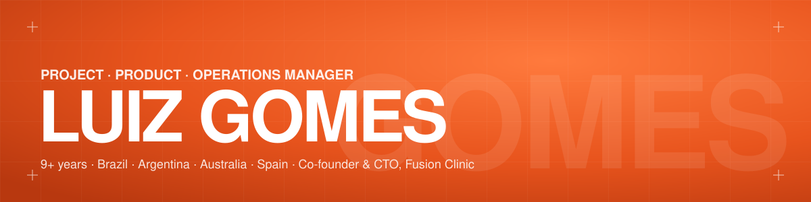

  
  
  

### 👋 Hi, I'm Luiz

Project, Product & Operations Manager with **9+ years** across Brazil, Argentina, Australia and Spain.
I turn business problems into products, decide with data and keep operations running.

- 🧡 **Co-founder & CTO, [Fusion Clinic](https://luiz-gomes-portfolio.vercel.app/#fusion)** — healthcare marketplace where professionals book consulting rooms by the hour. From first wireframe to the **Web Summit Lisbon** stage (2023).
- 📊 **Life Sprint** — Power BI dashboards for public health now replicated in **12+ Brazilian states**.
- ⚙️ **CONTHABIL** — digital transformation program that cut manual rework by **25%**.
- 🌏 **Melbourne** — operations across **12+ commercial sites** (SNL) and a luxury-cosmetics supply chain across three continents (Origani).
- 🎓 Master's in Software Engineering (UNLP, Argentina) · MBA in Project Management (USP) · PMI member and mentor.

👉 **Full case studies, live prototype and heatmaps: [luiz-gomes-portfolio.vercel.app](https://luiz-gomes-portfolio.vercel.app)**

---

### 🧰 Tools & technologies

**Product & UX**

  
  
  
  
  

**Data & BI**

  
  
  
  

**Operations & cloud**

  
  

**Web**

  
  
  
  
  
  

**Methods:** Agile · Scrum · OKRs · PMBOK · Discovery · Change management · Process mapping

---

### 📌 Featured

| Project | What it is |
|---|---|
| [**luiz-gomes-portfolio**](https://github.com/engluizgomes/luiz-gomes-portfolio) | My portfolio: bilingual (EN/PT), Fusion Clinic live case with process, live blueprint, heatmap and an interactive prototype. HTML, CSS, JS + GSAP on Vercel. |

### 🗣️ Languages
Portuguese (native) · Spanish (native) · English (professional) · French (intermediate) · German (basic)

📍 Natal, Brazil · open to remote roles
